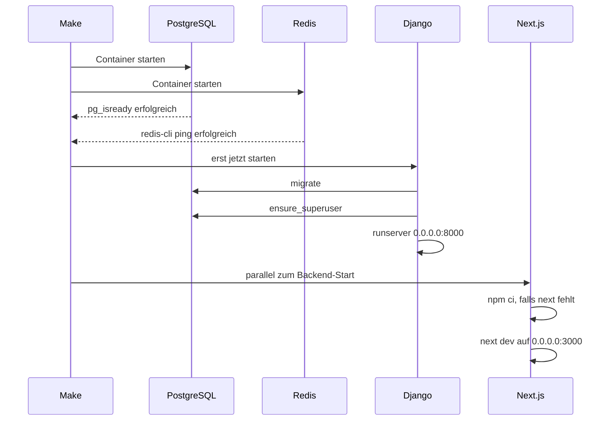

# Ubuntu-VM, Docker und erster Start

Dieses Kapitel bringt eine leere Ubuntu-Server-VM bis zum laufenden Stack. Am Ende antworten Frontend, API, PostgreSQL und Redis, und die Firewall lässt nur die Ports durch, die der Betrieb wirklich braucht.

Alle Befehle gelten für Ubuntu Server LTS. Die Docker-Quelle liest den Codenamen aus `/etc/os-release`, deshalb gelten dieselben Schritte für 24.04 und neuere LTS-Ausgaben. Gearbeitet wird als Benutzer mit `sudo`. Root bleibt für den Alltag aus.

## Was wo läuft

Auf dem Host liegen Git, Make, Python 3, Docker Engine und das Compose-Plugin. Python 3 auf dem Host führt nur `make create_app` und `make create_feature` aus.

Node, PostgreSQL, Redis, pytest, Ruff und der Next.js-Build laufen in Containern. Eine Installation von Node oder PostgreSQL auf dem Host ist für den Stack unnötig und belegt dieselben Ports.

| Dienst | Image | Port im Compose-Netz | Variable für den Host-Port |
|---|---|---|---|
| frontend | Next.js | 3000 | `FRONTEND_PORT` |
| backend | Django | 8000 | `BACKEND_PORT` |
| db | PostgreSQL 18 | 5432 | `POSTGRES_PORT` |
| redis | Redis 8.10 | 6379 | `REDIS_PORT` |

Der Host-Port ist die Tür auf der VM. Im Container bleiben die Ports fest. Django spricht die Datenbank über den Dienstnamen `db` auf Port 5432 an, Redis über `redis` auf Port 6379. Die Werte in `docker/.env` ändern die Tür auf der VM, den internen Port ändern sie nicht. Einzelheiten stehen in [Kapitel 2](02-umgebung-und-befehle.md).

## Größe der VM

| Ressource | Entwicklung | Server mit wenigen Benutzern |
|---|---|---|
| vCPU | 2 | 2 |
| RAM | 4 GiB, ruhiger mit 8 GiB | 4 GiB |
| Platte | 40 GiB | 40 GiB, Datenbankwachstum extra einplanen |
| Netz | SSH, optional das Frontend aus dem eigenen Netz | SSH, HTTP und HTTPS |

Der erste `make dev` baut zwei Images und installiert Python- sowie npm-Abhängigkeiten. Dafür braucht die Platte mehrere Gigabyte unter `/var/lib/docker`. PostgreSQL schreibt in das Volume `postgres_data`.

Zugang ausschließlich mit einem SSH-Schlüssel. Ein Passwort für SSH bleibt aus.

## System vorbereiten

```bash
sudo apt update
sudo apt upgrade -y
sudo timedatectl set-timezone Europe/Berlin
sudo hostnamectl set-hostname jd-template
```

Die Zeitzone betrifft die VM. Django speichert Zeitpunkte in UTC (`TIME_ZONE = "UTC"` in `backend/backend/settings.py`).

Pakete, die der Host selbst braucht:

```bash
sudo apt install -y ca-certificates curl git make python3 ufw
git --version
make --version
python3 --version
```

`python3` muss 3.11 oder neuer sein. Die Generatoren nutzen nur die Standardbibliothek.

Arbeitsverzeichnis, Besitz beim eigenen Benutzer:

```bash
sudo mkdir -p /opt/jd_template
sudo chown "$USER:$USER" /opt/jd_template
```

Ein Heimatverzeichnis ist genauso geeignet. Alle weiteren Befehle gelten im Verzeichnis, in dem die `Makefile` liegt.

## Docker Engine und Compose

Die Pakete `docker.io` und `docker-compose` aus Ubuntu liefern eine andere Zusammensetzung als die Engine, mit der dieses Repository geprüft wird. Vor der offiziellen Quelle kommen sie herunter, falls sie schon installiert sind:

```bash
for pkg in docker.io docker-doc docker-compose docker-compose-v2 podman-docker containerd runc; do
  sudo apt remove -y "$pkg"
done
```

Docker-Quelle und Engine, einschließlich Buildx und Compose-Plugin. Die Schritte entsprechen der Ubuntu-Anleitung von Docker Engine:

```bash
sudo apt update
sudo apt install -y ca-certificates curl
sudo install -m 0755 -d /etc/apt/keyrings
sudo curl -fsSL https://download.docker.com/linux/ubuntu/gpg -o /etc/apt/keyrings/docker.asc
sudo chmod a+r /etc/apt/keyrings/docker.asc

sudo tee /etc/apt/sources.list.d/docker.sources <<EOF
Types: deb
URIs: https://download.docker.com/linux/ubuntu
Suites: $(. /etc/os-release && echo "${UBUNTU_CODENAME:-$VERSION_CODENAME}")
Components: stable
Architectures: $(dpkg --print-architecture)
Signed-By: /etc/apt/keyrings/docker.asc
EOF

sudo apt update
sudo apt install -y docker-ce docker-ce-cli containerd.io docker-buildx-plugin docker-compose-plugin
```

Dienst beim Boot starten und sofort hochfahren:

```bash
sudo systemctl enable --now docker
sudo systemctl status docker --no-pager
```

Prüfung:

```bash
docker --version
docker compose version
sudo docker run --rm hello-world
```

`docker compose version` muss eine 2.x-Ausgabe zeigen. Die `Makefile` ruft `docker compose` auf. Das alte Binary `docker-compose` (mit Bindestrich) bleibt unbenutzt.

Der eigene Benutzer soll Docker ohne `sudo` rufen. Die Gruppe wirkt nach einer neuen Anmeldung:

```bash
sudo usermod -aG docker "$USER"
```

SSH-Sitzung beenden, neu verbinden, dann:

```bash
docker run --rm hello-world
```

Schlägt das ohne `sudo` fehl, ist die neue Gruppe in dieser Sitzung noch nicht aktiv. `groups` muss `docker` enthalten.

## UFW

UFW filtert, was die VM selbst annimmt. Zuerst die Regel für SSH, danach erst einschalten. Andernfalls endet die Sitzung beim Aktivieren.

```bash
sudo ufw default deny incoming
sudo ufw default allow outgoing
sudo ufw allow OpenSSH
sudo ufw enable
sudo ufw status verbose
```

Ausgehend ist erlaubt. Container erreichen damit Paketquellen, SMTP und eine Datenbank auf einem anderen Rechner. Eingehend bleibt zu, bis eine Regel den Port öffnet.

| Profil | Öffentlich auf der VM | Compose-Ports |
|---|---|---|
| Entwicklung über SSH-Tunnel | nur SSH | Frontend, Backend, PostgreSQL und Redis an `127.0.0.1` |
| Entwicklung im eigenen Netz | SSH, Frontend, Backend aus dem Netzbereich | PostgreSQL und Redis an `127.0.0.1` |
| Server | SSH, HTTP, HTTPS | nur das Frontend, und nur an `127.0.0.1`, davor Nginx |

PostgreSQL und Redis stehen in beiden Profilen nur auf dem Loopback. Ein veröffentlichtes `5432` oder `6379` auf allen Schnittstellen ist ein offener Datenbankzugang, sobald die VM eine Adresse im Netz hat. Die Vorlage `docker/.env.example` setzt einfache Passwörter für den lokalen Rechner.

### Docker-Ports und UFW

Eine Veröffentlichung in Compose (`ports:`) trägt Docker in die iptables-Kette `DOCKER` ein. Diese Kette wird vor den eingehenden UFW-Regeln ausgewertet. `sudo ufw deny 5432` schließt einen von Docker veröffentlichten Port deshalb nicht.

Zwei Folgen:

- Ein Port, den Compose an `0.0.0.0` bindet, ist aus dem Netz erreichbar, auch wenn UFW ihn nicht erlaubt.
- Ein Port, den Compose an `127.0.0.1` bindet, nimmt nur Verbindungen von der VM selbst an. UFW muss ihn dafür nicht öffnen. Ein SSH-Tunnel erreicht ihn, das öffentliche Netz nicht.

Profil Entwicklung über SSH-Tunnel. In `docker/compose.yml` die vier `ports`-Einträge auf das Loopback legen:

```yaml
ports:
  - "127.0.0.1:${POSTGRES_PORT}:5432"
```

Dieselbe Form für Redis (`6379`), Backend (`8000`) und Frontend (`3000`). Vom eigenen Rechner:

```bash
ssh -L 3000:127.0.0.1:3000 -L 8000:127.0.0.1:8000 user@vm
```

Danach ist das Frontend unter `http://127.0.0.1:3000` auf dem eigenen Rechner erreichbar. Die Cookies bleiben an diesen Rechner gebunden.

Profil Entwicklung im eigenen Netz. Frontend und Backend bleiben an `0.0.0.0`, PostgreSQL und Redis an `127.0.0.1`. Zusätzlich filtert die Kette `DOCKER-USER`, weil UFW die an `0.0.0.0` gebundenen Ports nicht sieht. `--dport` ist hier der Port im Container, nach der Umleitung durch Docker, also `3000` und `8000`, auch wenn `FRONTEND_PORT` auf der VM anders lautet.

Schnittstelle der VM ermitteln:

```bash
ip -4 route show default
```

Die Schnittstelle aus dieser Zeile unten als `eth0` einsetzen. `10.20.0.0/24` durch das eigene Netz ersetzen.

```bash
sudo install -m 0755 /dev/null /usr/local/sbin/docker-user-rules.sh
sudo tee /usr/local/sbin/docker-user-rules.sh >/dev/null <<'EOF'
#!/bin/sh
set -eu
IFACE=eth0
NET=10.20.0.0/24
iptables -F DOCKER-USER
iptables -A DOCKER-USER -m conntrack --ctstate RELATED,ESTABLISHED -j RETURN
iptables -A DOCKER-USER -i "$IFACE" -p tcp --dport 3000 -s "$NET" -j RETURN
iptables -A DOCKER-USER -i "$IFACE" -p tcp --dport 8000 -s "$NET" -j RETURN
iptables -A DOCKER-USER -i "$IFACE" -j DROP
iptables -A DOCKER-USER -j RETURN
EOF
sudo chmod 0755 /usr/local/sbin/docker-user-rules.sh
```

Die Regeln überleben einen Neustart nur, wenn ein Dienst sie nach Docker wieder setzt:

```bash
sudo tee /etc/systemd/system/docker-user-rules.service >/dev/null <<'EOF'
[Unit]
Description=DOCKER-USER Regeln
After=docker.service
Requires=docker.service

[Service]
Type=oneshot
ExecStart=/usr/local/sbin/docker-user-rules.sh
RemainAfterExit=yes

[Install]
WantedBy=multi-user.target
EOF
sudo systemctl daemon-reload
sudo systemctl enable --now docker-user-rules.service
```

`sudo iptables -S DOCKER-USER` zeigt die vier Regeln. PostgreSQL (`5432`) und Redis (`6379`) fehlen darin und sind zusätzlich an `127.0.0.1` gebunden.

## Repository und Umgebung

```bash
cd /opt/jd_template
git clone <repository-url> .
cp docker/.env.example docker/.env
```

`docker/.env` und `docker/.env.prod` stehen in `.gitignore`. Die Beispielwerte für Datenbank, Redis und den Superuser sind nur für einen Rechner gedacht, den niemand sonst erreicht. Auf einer VM im Netz die drei Passwörter und `SECRET_KEY` vor dem ersten Start ersetzen. `make urls` liest die Datei als Shell: Werte mit Leerzeichen stehen in Anführungszeichen.

```bash
python3 -c 'import secrets; print(secrets.token_urlsafe(64))'
```

Die Ausgabe wird `SECRET_KEY`. Danach die Host-Ports prüfen. `ss` zeigt, was schon belegt ist:

```bash
sudo ss -tulpn | awk 'NR==1 || /:3000|:8000|:5432|:6379/'
```

Kollidiert ein Port, nur die passende Variable in `docker/.env` ändern. Ein belegtes `5432` auf dem Host wird zu `POSTGRES_PORT=5433`. Django im Container bleibt auf `5432`.

## Was `make dev` der Reihe nach tut

`make dev` führt aus:

```bash
docker compose --env-file docker/.env -f docker/compose.yml up -d
```

Compose liest `docker/.env`, ersetzt die Variablen in `docker/compose.yml` und startet die vier Dienste im Projekt `jd_template`.



1. PostgreSQL initialisiert das Volume `postgres_data` unter `/var/lib/postgresql`, wenn es leer ist. Benutzer, Datenbankname und Passwort aus `POSTGRES_USER`, `POSTGRES_DB` und `POSTGRES_PASSWORD` gelten bei dieser ersten Initialisierung. Ein späteres Ändern des Passworts in `docker/.env` ändert die bestehende Datenbank nicht. Der Healthcheck ruft `pg_isready` mit demselben Benutzer und Datenbanknamen.
2. Redis startet mit `--requirepass` aus `REDIS_PASSWORD`. `REDISCLI_AUTH` liegt im Container, damit der Healthcheck `redis-cli ping` ohne sichtbares Passwort in der Prozessliste auskommt.
3. Das Backend wartet auf beide Healthchecks (`depends_on` mit `condition: service_healthy`). Danach überschreibt Compose für diesen einen Dienst `POSTGRES_HOST=db`, `POSTGRES_PORT=5432`, `REDIS_HOST=redis` und `REDIS_PORT=6379`. Die Host-Ports aus `docker/.env` gelten im Backend-Container nicht.
4. Der Befehl des Dev-Backends ist eine Kette: `python manage.py migrate --noinput`, dann `python manage.py ensure_superuser`, dann `runserver 0.0.0.0:8000`. `ensure_superuser` legt den Benutzer aus `DJANGO_SUPERUSER_USERNAME` an, wenn er fehlt, und lässt ihn unverändert, wenn er schon existiert.
5. Der Backend-Healthcheck fragt `http://127.0.0.1:8000/api/v1/ready/` ab und sendet `X-Forwarded-Proto: https`. `ready` prüft PostgreSQL und Redis. Der Header verhindert, dass eine HTTPS-Umleitung den Check auf eine andere Adresse schickt. `start_period` ist 40 Sekunden, weil die erste Migration länger dauert als ein späterer Start.
6. Das Frontend wartet nur darauf, dass der Backend-Container gestartet ist, nicht darauf, dass er gesund ist. Der Einstieg `/usr/local/bin/dev-entrypoint.sh` führt `npm ci` aus, wenn `node_modules/.bin/next` im Volume fehlt, und startet danach `next dev` auf `0.0.0.0:3000`. Das erste Mal dauert das Minuten. `node_modules` und `.next` liegen in eigenen Volumes, damit ein Bind-Mount des Quelltexts sie nicht mit dem Host überschreibt.
7. Der Quelltext von Backend und Frontend ist in die Container gemountet. Eine gespeicherte Datei lädt Django und Next.js neu. Neue Python-Pakete brauchen `make install-backend` und einen Neustart des Backends. Neue npm-Pakete brauchen `make install-frontend`.

Images für Backend und Frontend baut Compose beim ersten `up`, weil sie lokal noch fehlen. PostgreSQL und Redis kommen von Docker Hub (`make pull` holt diese beiden Basis-Images vorab).

## Ersten Start prüfen

```bash
make dev
make ps
make urls
```

`make ps` soll für `db`, `redis` und nach kurzer Zeit für `backend` den Status `healthy` zeigen. Das Frontend hat im Dev-Compose keinen Healthcheck. Es ist bereit, sobald das Log `Ready` meldet:

```bash
make logs frontend
```

Mit den Ports aus der Vorlage, solange `docker/.env` sie nicht geändert hat:

| Oberfläche | Adresse auf der VM |
|---|---|
| Frontend | `http://127.0.0.1:3000` |
| Health | `http://127.0.0.1:8000/api/v1/health/` |
| Ready | `http://127.0.0.1:8000/api/v1/ready/` |
| Swagger | `http://127.0.0.1:8000/api/docs/` |
| OpenAPI | `http://127.0.0.1:8000/api/schema/` |
| Admin | `http://127.0.0.1:8000/admin/` |

```bash
curl -fsS http://127.0.0.1:8000/api/v1/health/
curl -fsS -H 'X-Forwarded-Proto: https' http://127.0.0.1:8000/api/v1/ready/
```

Health antwortet `{"status":"ok"}` und prüft keine Abhängigkeit. Ready antwortet mit `ok`, sobald Datenbank und Redis erreichbar sind, und mit HTTP 503, wenn eine der beiden Prüfungen fehlschlägt. Der Körper nennt dann `error` und keine Verbindungsdaten.

Anmeldung im Frontend und im Django-Admin nutzen denselben Superuser aus `DJANGO_SUPERUSER_*`. Die Sitzung ist ein Cookie. Cookies hängen am Hostnamen, nicht am Port. Wer Frontend und Admin über `127.0.0.1` öffnet, teilt die Sitzung zwischen Port 3000 und Port 8000.

Ohne Sitzung leitet das Frontend auf `/anmelden`. Offen sind `/anmelden`, `/registrieren`, `/passwort-vergessen`, `/passwort-setzen` und `/email-bestaetigen`. Nach der Anmeldung öffnet `/dashboard`.

Der Browser spricht im Alltag das Frontend an. Next.js leitet `/accounts` und `/media` an `http://backend:8000` weiter (`API_ORIGIN`). Swagger und Admin laufen direkt am Backend-Port.

## Alltag auf der VM

```bash
make logs
make logs backend
make restart backend
make down
```

`make down` entfernt die Container und behält die Volumes. Datenbank, `node_modules` und der Next-Cache bleiben. Nach einem Neustart der VM startet Docker den Dienst, Compose startet die Container nur, wenn sie mit einer Neustart-Regel versehen sind. Die Compose-Dateien setzen keine `restart`-Policy. Nach einem Reboot der VM also erneut `make dev`.

`make destroy` löscht die Volumes, einschließlich der Datenbank. Das ist der Weg, wenn das initiale PostgreSQL-Passwort falsch gesetzt wurde und die Daten entbehrlich sind.

## Produktion auf derselben VM

Der Produktionsstapel nutzt `docker/compose.prod.yml` und `docker/.env.prod`. Backend, PostgreSQL und Redis veröffentlichen keinen Host-Port. Nur das Frontend bindet `FRONTEND_PORT`.

```bash
cp docker/.env.prod.example docker/.env.prod
```

Vor `make prod` in `docker/.env.prod` ersetzen:

| Variable | Wert |
|---|---|
| `SECRET_KEY` | Ausgabe von `secrets.token_urlsafe(64)` |
| `POSTGRES_PASSWORD`, `REDIS_PASSWORD`, `DJANGO_SUPERUSER_PASSWORD` | eigene lange Werte |
| `DEBUG` | `false`, die Datei setzt das bereits |
| `ALLOWED_HOSTS` | öffentlicher Hostname, zum Beispiel `example.com` |
| `CSRF_TRUSTED_ORIGINS` | `https://example.com` |
| `FRONTEND_ORIGIN` | `https://example.com`, ohne Pfad und ohne Schrägstrich am Ende |
| `EMAIL_*` | SMTP-Server, der die Bestätigungs- und Passwort-Mails annimmt |

`DEBUG=false` schaltet sichere Cookies, die HTTPS-Umleitung und HSTS ein. Django akzeptiert die Verbindung als HTTPS, wenn `X-Forwarded-Proto` den Wert `https` hat (`SECURE_PROXY_SSL_HEADER`). Ein vom Client frei gesetzter Wert darf den Proxy nicht erreichen. Der Proxy überschreibt den Header.

Nginx auf der VM, Zertifikat über Certbot, Frontend nur am Loopback:

```bash
sudo apt install -y nginx certbot python3-certbot-nginx
sudo ufw allow 'Nginx Full'
```

In `docker/compose.prod.yml` die Veröffentlichung des Frontends auf das Loopback legen:

```yaml
ports:
  - "127.0.0.1:${FRONTEND_PORT}:3000"
```

Nginx-Site, `example.com` durch den echten Namen ersetzen:

```nginx
server {
    listen 80;
    server_name example.com;

    location / {
        proxy_pass http://127.0.0.1:3000;
        proxy_set_header Host $host;
        proxy_set_header X-Forwarded-Proto $scheme;
        proxy_set_header X-Forwarded-For $proxy_add_x_forwarded_for;
    }
}
```

```bash
sudo nginx -t
sudo systemctl reload nginx
sudo certbot --nginx -d example.com
```

Certbot ergänzt den TLS-Server. Danach steht in der HTTPS-Site `X-Forwarded-Proto https`, weil `$scheme` dort `https` ist.

```bash
make prod
```

`make prod` baut die Stufe `prod` und startet sie. Das Backend-Image läuft als Benutzer `app` (UID 1000) und startet Gunicorn mit drei Workern über `backend/gunicorn.conf.py`. Static-Dateien sammelt das Image beim Bauen mit `collectstatic` und liefert sie über WhiteNoise aus. Das Frontend-Image führt `next build` aus, installiert die Laufzeit ohne Dev-Pakete und startet als Benutzer `node`. Markenname und API-Texte sind Build-Argumente. Eine Änderung von `PROJECT_NAME`, `API_TITLE`, `API_DESCRIPTION` oder `API_VERSION` in der Produktion braucht ein neues Image, also erneut `make prod`.

### Header bis zu Django durchreichen

Nginx setzt `X-Forwarded-Proto` auf der Verbindung zum Frontend. Django sieht diese Verbindung nicht. Next.js ruft Django unter `http://backend:8000` auf. Der Proxy in `frontend/src/app/accounts/[...path]/route.ts` reicht `cookie`, `x-csrftoken`, `content-type`, `accept` und `accept-language` weiter und lässt `x-forwarded-proto` aus.

Solange der Header bei Django fehlt und `DEBUG` aus ist, antwortet Django auf unsichere Methoden mit einer Weiterleitung auf HTTPS. Der Healthcheck setzt den Header selbst und bleibt davon unberührt. Anmeldung, Registrierung und die übrigen Account-Aufrufe über das Frontend brauchen den Header auf dem Weg zu Django.

In `forwardedRequestHeaders` den Namen ergänzen:

```ts
const forwardedRequestHeaders = [
  "cookie",
  "x-csrftoken",
  "content-type",
  "accept",
  "accept-language",
  "x-forwarded-proto",
];
```

Dieselbe Ergänzung gehört in jeden weiteren Proxy, den [Kapitel 3](03-eigene-implementierung.md) für eine neue App anlegt. Medien unter `/media` liest Django ohne diesen Header, weil `GET` von der Umleitung auf die HTTPS-Adresse geschickt würde. Für Avatare `x-forwarded-proto` auch in `frontend/src/app/media/[...path]/route.ts` an den Upstream setzen.

Nach der Änderung das Produktions-Image neu bauen: `make prod`.

Bereitschaft aus dem Compose-Netz, ohne den Backend-Port zu veröffentlichen:

```bash
docker compose --env-file docker/.env.prod -f docker/compose.prod.yml exec -T backend \
  python -c "import urllib.request; urllib.request.urlopen(urllib.request.Request('http://127.0.0.1:8000/api/v1/ready/', headers={'X-Forwarded-Proto': 'https'}))"
```

Von außen zählt die Anmeldeseite:

```bash
curl -fsSI https://example.com/anmelden
```

Betrieb, Cookies und die beiden Checks beschreibt [docs/rules/deploy.md](../rules/deploy.md). Vor einem öffentlichen Start:

```bash
make check-deploy
make check-migrations
```

Beide Ziele laufen gegen den Dev-Container. `check-deploy` setzt für diesen einen Aufruf `DEBUG=false`, einen eigenen Schlüssel und den SMTP-Mailer.

## Updates

```bash
sudo apt update && sudo apt upgrade -y
make pull
make build
make restart dev
```

`make pull` holt neue PostgreSQL- und Redis-Images. `make build` baut Backend und Frontend mit dem Layer-Cache. `make rebuild` verwirft den Cache und startet danach. Ein Image-Update ersetzt das Volume nicht. Die Datenbank bleibt.

## Wenn der Start hängen bleibt

| Beobachtung | Ursache und nächster Schritt |
|---|---|
| `permission denied` auf `/var/run/docker.sock` | Benutzer ist nicht in der Gruppe `docker`, oder die SSH-Sitzung stammt von vor `usermod`. Neu anmelden |
| `port is already allocated` | Host-Port in `docker/.env` ändern, `make down`, erneut `make dev` |
| Backend wird nicht `healthy`, Log sagt `password authentication failed` | Das Volume wurde mit einem anderen `POSTGRES_PASSWORD` initialisiert. Passwort in der Datenbank ändern oder, wenn die Daten entbehrlich sind, `make destroy` und erneut `make dev` |
| Backend-Log: `SECRET_KEY fehlt` | `DEBUG` ist aus und `SECRET_KEY` ist leer. Im Dev-`.env` bleibt `DEBUG=true`, oder der Schlüssel wird gesetzt |
| Frontend-Log bleibt bei `npm ci` | Erster Lauf. `make logs frontend` weiter beobachten. Abbruch mit vollem Log: Platte prüfen (`df -h`) |
| `ready` liefert 503 | `make logs db` und `make logs redis`. Danach `make logs backend` |
| Seite lädt, Anmeldung leitet im Kreis | `CSRF_TRUSTED_ORIGINS` enthält die genaue Browser-Adresse inklusive Schema und Port. In der Produktion zusätzlich `x-forwarded-proto` im Next-Proxy |
| UFW ist an, SSH bricht ab | Nur von der Konsole der VM: `sudo ufw allow OpenSSH` und `sudo ufw enable`. Die Docker-Ports bleiben davon unberührt |
| Port ist in UFW zu und trotzdem offen | Compose bindet ihn an `0.0.0.0`. Auf `127.0.0.1` umstellen oder `DOCKER-USER` filtern |

Die aufgelöste Compose-Datei zeigt, welche Werte wirklich gelten:

```bash
make config
```
